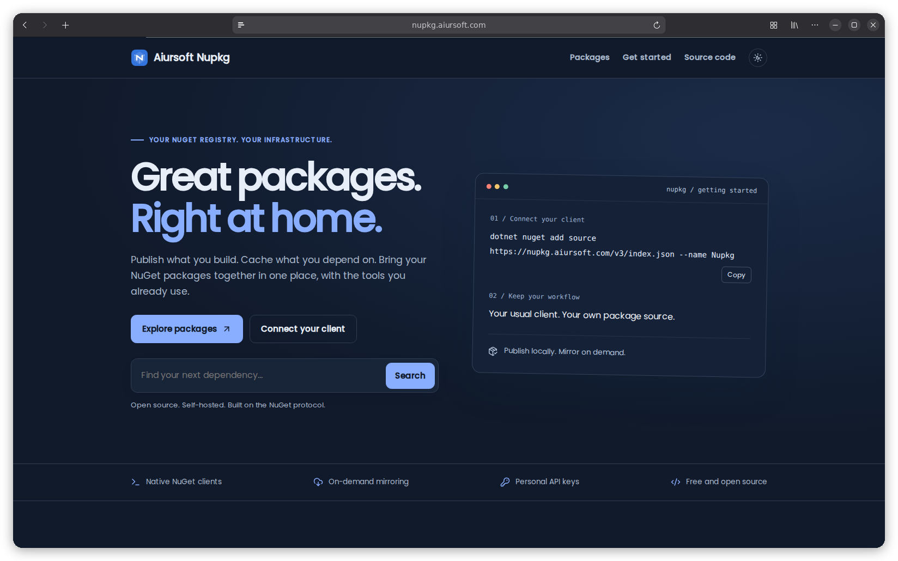

# Aiursoft Nupkg

<a name="nupkg"></a>

[](https://github.com/aiursoftweb/nupkg/blob/master/LICENSE)
[](https://gitlab.aiursoft.com/aiursoft/nupkg/-/pipelines)
[](https://gitlab.aiursoft.com/aiursoft/nupkg/-/pipelines)
[](https://s360.aiursoft.com/SupplyChain?tab=projects&project=aiursoft%2Fnupkg&scope=baseline&ecosystem=all)
[](https://manhours.aiursoft.com/r/github.com/aiursoftweb/nupkg.html)
[](https://nupkg.aiursoft.com)
[](https://hub.docker.com/r/aiursoft/nupkg)

Nupkg is a NuGet package registry built on Aiursoft Template. Publish your packages, browse versions and dependencies, and cache packages from an upstream feed using standard NuGet tools.



## Overview

### What is Nupkg?

<a name="what-is-nupkg"></a>

- A NuGet v3 feed with package and symbol publishing support.
- A package catalog with versions, dependencies, reverse dependencies and install commands for libraries, tools and templates.
- Personal publishing keys with expiration, revocation and package ownership.
- Optional on-demand upstream mirroring: requested packages are downloaded and cached locally.
- Optional S360 admission using a single internal-source policy, using package rules and known vulnerability data.
- Shared Aiursoft accounts, OIDC, roles, themes and localization.

Downloads are public. **Publish Packages** allows an account to create personal keys and maintain its own package names. **Manage Packages** allows maintaining all packages and assigning ownership. Imported and mirrored names remain reserved until assigned by an administrator.

The npm sibling is [Nopkg](https://github.com/aiursoftweb/nopkg).

## Try

Browse the running [Nupkg instance](https://nupkg.aiursoft.com).

## Install with Docker

Run the installer with the desired port (omit it to choose an available port):

```bash
curl -fsSL https://raw.githubusercontent.com/aiursoftweb/nupkg/master/install.sh | sudo bash -s -- 8080
```

Installation starts after three seconds; press Ctrl+C to cancel. Then open `http://localhost:8080`.

## Run manually

<a name="run-locally"></a>

Requires .NET 10 and Node.js.

```sh
cd src/Aiursoft.Nupkg/wwwroot
npm ci
cd ..
dotnet run
```

The default local administrator is `admin@default.com` with password `Admin@123456!`. Configure authentication and roles before exposing a deployment.

## Run in Microsoft Visual Studio

1. Prepare the frontend assets as described above.
2. Open `Aiursoft.Nupkg.sln`, select `Aiursoft.Nupkg` as the startup project, and press `F5`.

## Run in Docker

First, install Docker [here](https://docs.docker.com/get-docker/).

Then run the following commands in a Linux shell:

```bash
image=aiursoft/nupkg
appName=nupkg
sudo docker pull $image
sudo docker run -d --name $appName --restart unless-stopped -p 5000:5000 --mount type=volume,source=$appName-data,target=/data $image
```

That will start a web server at `http://localhost:5000`. Keep `/data` persistent for application configuration, database files and package storage.

## Usage

### Use the feed

Add your server as a package source:

```sh
dotnet nuget add source https://nupkg.example.com/v3/index.json --name Nupkg
dotnet add package Your.Package --source https://nupkg.example.com/v3/index.json
```

Create a personal key under **Personal > API Keys**, then publish:

```sh
dotnet nuget push ./Your.Package.1.0.0.nupkg \
  --source https://nupkg.example.com/v3/index.json \
  --api-key YOUR_PERSONAL_KEY
```

The first authorized publisher owns a new package name and its versions. Manage imported names under **Packages > Package ownership**.

### Deploy

Use the [Docker image](https://hub.docker.com/r/aiursoft/nupkg) or the repository installer:

```sh
curl -fsSL https://raw.githubusercontent.com/aiursoftweb/nupkg/master/install.sh | sudo bash -s -- 8080
```

Persist `/data` for the default SQLite database and package files. For other databases, persist the configured database and `Storage:Path`. The NuGet v3 service index is `/v3/index.json`; publishing uses `/api/v2/package`; health checks use `/health`.

With S360 control disabled, to cache an upstream feed, set `Mirror:Enabled=true` and `Mirror:PackageSource=https://api.nuget.org/v3/index.json`. Packages are cached when requested; this does not copy the entire upstream catalog.

For approved-only on-demand mirroring, deploy S360 with its artifact admission API first, then configure Nupkg:

```text
Mirror__Enabled=true
Mirror__PackageSource=https://api.nuget.org/v3/index.json
S360Mirror__Enabled=true
S360Mirror__Server=https://s360.aiursoft.com
S360Mirror__CheckKey=<personal S360 check key>
S360Mirror__PrefetchEnabled=false
S360Mirror__IntervalMinutes=5
```

Keep the key outside Git; baseline permission is unnecessary. Set `S360Mirror__PolicySource` to this registry's URL (for example, `https://packages.example.com/v3/index.json`) and permit that URL in S360's `SupplyChain:NuGetSources`. Approve each package name and version range there once. Leave `PolicySource` empty to use the upstream URL as the policy identity. **S360 does not need an upstream mapping and never downloads package files.**

Nupkg asks the existing `POST /api/artifacts/assess` API whether each name and version is allowed by policy and current vulnerability data. It sends no archive or file hash. Version discovery uses upstream metadata; an approved version is downloaded only when first requested. Nupkg checks the archive identity and records its own SHA256 before committing the cache, then checks policy again. Concurrent requests for one version share a download. Run one application instance per filesystem package store.

Search, version metadata and cached mirror downloads use current S360 decisions. Revoked mirror versions cannot be downloaded, including through direct cached URLs. S360 failures or unavailable vulnerability data return 503 rather than falling back to unrestricted mirroring. Package responses use `Cache-Control: no-store`; reverse proxies must respect it. Previously downloaded client files cannot be revoked remotely.

**Local publishing is separate:** an authorized upload permanently makes that package name locally managed. Local packages bypass mirror admission, and missing versions are never fetched upstream. Project baseline reports and vulnerability alerts remain independent of package downloads.

The Jobs page can prefetch approved, previously reported concrete versions. Enable scheduled prefetch with `S360Mirror__PrefetchEnabled=true`; `IntervalMinutes` defaults to 5. Prefetch is optional and disabled by default. It uses the same policy checks and download locks as lazy requests, without overwriting existing conflicting archives or local package names. NuGet v2 upstreams are not supported in controlled mode.

Cached packages and metadata remain usable with the upstream offline while S360 remains reachable and approves them. Prepare the full dependency closure before disconnecting the upstream. `Mirror__Enabled=false` pauses new downloads while retaining S360 read checks; disabling `S360Mirror__Enabled` disables those checks.

Existing databases and archives are retained. Legacy ownerless cache entries are adopted after Nupkg checks their package identity and current policy; their locally recorded provenance is distinct from S360's policy decision. Nupkg does not create approval rules or publish project baselines.

## Configuration

The application defaults are defined in [`src/Aiursoft.Nupkg/appsettings.json`](src/Aiursoft.Nupkg/appsettings.json). The Docker image initializes `/data/appsettings.json` on its first start and keeps it for later starts; persist `/data`. Override nested values with double-underscore environment variables, such as `Logging__LogLevel__Default`.

```jsonc
{
  // Optional legacy server-wide key. Personal keys are managed under Personal > API Keys.
  "ApiKey": "",
  "EnableLegacyApiKey": true,
  // Explicit BaGet compatibility: an empty legacy key permits anyone to modify every package.
  "AllowAnonymousPublishing": false,
  "PackageDeletionBehavior": "Unlist",
  "AllowPackageOverwrites": false,
  "IsReadOnlyMode": false,
  "Search": { "Type": "Database" },
  "Mirror": { "Enabled": false, "Legacy": false, "PackageSource": "https://api.nuget.org/v3/index.json" },
  "S360Mirror": {
    "Enabled": false,
    // Set to this registry URL to use one internal-source S360 policy. Empty keeps origin-based admission.
    "PolicySource": "",
    "PrefetchEnabled": false,
    "Server": "https://s360.aiursoft.com",
    "CheckKey": "",
    "IntervalMinutes": 5
  },
  "ConnectionStrings": {
    // True: cache EF Core query results in this process. False: read from the database on every query.
    "AllowCache": "True",

    // Sqlite: use a local database file and no database server. MySql: use an external MySQL server.
    // When changing this value, also replace DefaultConnection with a connection string for that provider.
    "DbType": "Sqlite",
    // With Sqlite, this creates app.db in the process working directory and applies migrations at startup.
    "DefaultConnection": "DataSource=app.db;Cache=Shared"

    // MySql requires a reachable server, database, user, and password. The application applies migrations at startup.
    // sudo docker run -d --name db -e MYSQL_RANDOM_ROOT_PASSWORD=true -e MYSQL_DATABASE=nupkg -e MYSQL_USER=nupkg -e MYSQL_PASSWORD=nupkg_password -p 3306:3306 hub.aiursoft.com/mysql
    //"DbType": "MySql",
    //"DefaultConnection": "Server=localhost;Database=nupkg;Uid=nupkg;Pwd=nupkg_password;"
  },
  "Storage": {
    "Type": "FileSystem",
    // Persistent root for NuGet packages and symbols, public Workspace files, and private Vault files.
    // This is not an S3 or MinIO bucket.
    // The Docker image changes /tmp/data to /data; mount /data as a persistent volume in production.
    "Path": "/tmp/data",

    // Optional second hostname for this application's own /download endpoints; this is not an S3 or MinIO URL.
    // Example: set https://files.example.com, point that DNS name to this server, and add this Caddy route:
    // files.example.com {
    //     reverse_proxy 127.0.0.1:5000
    // }
    // Replace 127.0.0.1:5000 with the same upstream used by the web UI. Leave empty to use the UI hostname.
    "PublicOrigin": "",

    // False: verified images and configured media can open on the normal web hostname.
    // True: inline viewing works only through PublicOrigin; the same request on the UI hostname downloads the file.
    // True requires PublicOrigin plus DNS, TLS, and a reverse-proxy route to this same application instance.
    "RequireDedicatedInlineOrigin": false,

    // False: only verified images and SafeInlineMediaExtensions open in the browser; every other file downloads.
    // True: every file type may open through PublicOrigin, and HTML or SVG scripts may run there.
    // True requires RequireDedicatedInlineOrigin=true and a PublicOrigin that receives no application cookies.
    "AllowArbitraryInlineOnDedicatedOrigin": false,

    // File extensions allowed to open after content-signature validation. Empty means no extra audio, video, or SVG.
    // Supported values are mp3, mp4, ogg, svg, wav, and webm. This does not grant upload permission.
    "SafeInlineMediaExtensions": ["svg"],

    // SVG opens only when svg is enabled above and its Workspace path starts with an entry in this list.
    // Example: [ "markdown-images" ]. Empty means every SVG downloads.
    "SafeInlineSvgSubfolders": ["project-logo"],

    // These values are copied into newly issued signed upload tokens; existing tokens keep their old policy.
    "UploadPolicy": {
      // False: a valid signed upload token is enough. True: the uploader must also be signed in to this application.
      "RequireAuthenticatedUser": false,

      // False: preserve spaces in uploaded file names. True: save each space as a hyphen.
      "ReplaceSpacesWithHyphens": false
    }
  },
  "AppSettings": {
    // Local: use built-in accounts and passwords. OIDC: redirect sign-in to an external identity provider.
    // OIDC also requires the OIDC section below and a provider callback URL of https://<web-host>/signin-oidc.
    "AuthProvider": "Local",

    // Empty: assign no automatic role. Otherwise, assign this role to every new local or OIDC user.
    // With Local, create the role first. With OIDC, the application creates it during account synchronization.
    "DefaultRole": "",

    // False: sign-in ends when the browser session closes. True: issue a persistent sign-in cookie.
    "PersistsSignIn": false,

    // This section is used only when AuthProvider is OIDC.
    "OIDC": {
      // Provider discovery base URL. It must be reachable by the application and should use HTTPS in production.
      "Authority": "https://auth.aiursoft.com/application/o/nupkg",
      // Client identifier created for this application in the OIDC provider.
      "ClientId": "",
      // Client secret created by the provider. Set AppSettings__OIDC__ClientSecret instead of committing a real secret.
      "ClientSecret": "",

      // Claim containing role names. On every login, local roles are replaced by these roles plus DefaultRole.
      "RolePropertyName": "groups",
      // Required claim used as the local username when an OIDC account is first created.
      "UsernamePropertyName": "preferred_username",
      // Required claim copied to the local display name on every login.
      "UserDisplayNamePropertyName": "name",
      // Required unique email claim. The provider must keep it verified, unique, and stable.
      "EmailPropertyName": "email",
      // Required immutable account identifier. Keep this mapped to the standard OIDC sub claim.
      "UserIdentityPropertyName": "sub"
    },

    // This section is used only when AuthProvider is Local.
    "Local": {
      // True: show self-registration and allow new local accounts. False: existing users can sign in, but cannot register.
      "AllowRegister": true,
      // True: require only six characters. False: require eight characters with upper, lower, digit, and symbol.
      "AllowWeakPassword": true
    }
  },
  "GlobalSettings": {
    // Leave an entry commented to use the database value or built-in default.
    // Uncommenting an entry forces that value and overrides changes made in the administration UI.

    // True: users may change their display nickname. False: only administrators control it.
    // "Allow_User_Adjust_Nickname": "True",
    // Text shown as the brand name in the footer.
    // "BrandName": "Aiursoft",
    // URL opened when a user clicks the footer brand name.
    // "BrandHomeUrl": "https://www.aiursoft.com/",
    // Mainland China ICP license number. Empty hides it.
    // "Icp": "",
    // Application name shown in the web interface.
    // "ProjectName": "Aiursoft Nupkg"
  },
  "Logging": {
    "LogLevel": {
      // Minimum level for application logs. Typical values: Debug, Information, Warning, Error, or None.
      "Default": "Information",
      // Separate minimum level for ASP.NET Core framework logs; Warning reduces routine request noise.
      "Microsoft.AspNetCore": "Warning"
    },
    "Clickhouse": {
      // False: do not send logs to ClickHouse. True: create TableName at startup and send logs in batches.
      // Before enabling, provide a reachable ClickHouse server and valid credentials in ConnectionString.
      "Enabled": false,
      // ClickHouse host, protocol, port, credentials, and database. Used only when Enabled is true.
      "ConnectionString": "Host=localhost;Protocol=http;Port=8123;User=default;Password=;Database=AspNetCoreLogs",
      // ClickHouse table created and used for application logs when Enabled is true.
      "TableName": "NupkgLogs"
    }
  },
  // ASP.NET Core Host-header allowlist; this is not a CORS setting.
  // * accepts every hostname. In production, use semicolon-separated names such as example.com;www.example.com.
  "AllowedHosts": "*"
}
```

### Shared settings

- `ConnectionStrings` selects the database provider and connection. Prepare the external database before choosing MySQL; keep the SQLite file persistent when using SQLite.
- `Storage` configures local application files. Keep the storage directory persistent and use the documented hostname and upload policies for shared downloads.
- `AppSettings` controls authentication and account synchronization. Choose local accounts or configure the OIDC authority, client and `/signin-oidc` callback; use environment variables for credentials.
- Uncommented `GlobalSettings` entries override the database-backed administration settings. Leave entries commented to use the stored values or application defaults.
- `Logging:LogLevel` controls application and framework verbosity. Configure the optional ClickHouse exporter only when its server and credentials are ready.
- `AllowedHosts` is the ASP.NET Core Host-header allowlist, not a CORS setting.

## How to contribute

There are many ways to contribute to the project: logging bugs, submitting pull requests, reporting issues, and creating suggestions.

Even if you have push rights on the repository, you should create a personal fork and create feature branches there when you need them. This keeps the main repository clean and your workflow cruft out of sight.

We're also interested in your feedback on the future of this project. You can submit a suggestion or feature request through the issue tracker. To make this process more effective, we're asking that these include more information to help define them more clearly.

## License

<a name="credits"></a>

The application foundation comes from [Aiursoft Template](https://github.com/aiursoftweb/template). The NuGet protocol, indexing, storage and package metadata implementation derives from BaGet. See `LICENSE`, `BAGET-LICENSE` and `THIRD-PARTY-NOTICES`.
