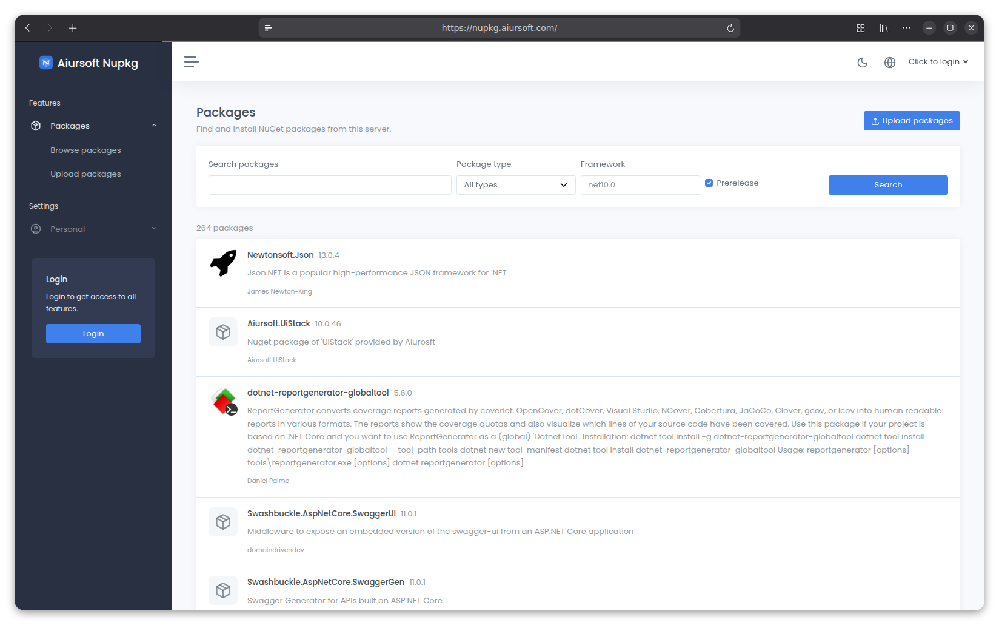

# Nupkg

[](https://github.com/aiursoftweb/nupkg/blob/master/LICENSE)
[](https://gitlab.aiursoft.com/aiursoft/nupkg/-/pipelines)
[](https://gitlab.aiursoft.com/aiursoft/nupkg/-/pipelines)
[](https://s360.aiursoft.com/SupplyChain?tab=projects&project=aiursoft%2Fnupkg&scope=baseline&ecosystem=all)
[](https://manhours.aiursoft.com/r/github.com/aiursoftweb/nupkg.html)
[](https://nupkg.aiursoft.com)
[](https://hub.docker.com/r/aiursoft/nupkg)

Nupkg is a NuGet package registry built on Aiursoft Template. Publish your packages, browse versions and dependencies, and cache packages from an upstream feed using standard NuGet tools.



## Try

Browse the running [Nupkg instance](https://nupkg.aiursoft.com).

## What is Nupkg?

- A NuGet v3 feed with package and symbol publishing support.
- A package catalog with versions, dependencies, reverse dependencies and install commands for libraries, tools and templates.
- Personal publishing keys with expiration, revocation and package ownership.
- Optional on-demand upstream mirroring: requested packages are downloaded and cached locally.
- Optional S360 admission using a single internal-source policy, with independent upstream verification.
- Shared Aiursoft accounts, OIDC, roles, themes and localization.

Downloads are public. **Publish Packages** allows an account to create personal keys and maintain its own package names. **Manage Packages** allows maintaining all packages and assigning ownership. Imported and mirrored names remain reserved until assigned by an administrator.

The npm sibling is [Nopkg](https://github.com/aiursoftweb/nopkg).

## Use the feed

Add your server as a package source:

```sh
dotnet nuget add source https://nupkg.example.com/v3/index.json --name Nupkg
dotnet add package Your.Package --source https://nupkg.example.com/v3/index.json
```

Create a personal key under **Personal > API Keys**, then publish:

```sh
dotnet nuget push ./Your.Package.1.0.0.nupkg \
  --source https://nupkg.example.com/v3/index.json \
  --api-key YOUR_PERSONAL_KEY
```

The first authorized publisher owns a new package name and its versions. Manage imported names under **Packages > Package ownership**.

## Run locally

Requires .NET 10 and Node.js.

```sh
cd src/Aiursoft.Nupkg/wwwroot
npm ci
cd ..
dotnet run
```

The default local administrator is `admin@default.com` with password `Admin@123456!`. Configure authentication and roles before exposing a deployment.

## Deploy

Use the [Docker image](https://hub.docker.com/r/aiursoft/nupkg) or the repository installer:

```sh
curl -fsSL https://raw.githubusercontent.com/aiursoftweb/nupkg/master/install.sh | sudo bash -s -- 8080
```

Persist `/data` for the default SQLite database and package files. For other databases, persist the configured database and `Storage:Path`. The NuGet v3 service index is `/v3/index.json`; publishing uses `/api/v2/package`; health checks use `/health`.

With S360 control disabled, to cache an upstream feed, set `Mirror:Enabled=true` and `Mirror:PackageSource=https://api.nuget.org/v3/index.json`. Packages are cached when requested; this does not copy the entire upstream catalog.

For approved-only on-demand mirroring, deploy S360 with its artifact admission API first, then configure Nupkg:

```text
Mirror__Enabled=true
Mirror__PackageSource=https://api.nuget.org/v3/index.json
S360Mirror__Enabled=true
S360Mirror__Server=https://s360.aiursoft.com
S360Mirror__CheckKey=<personal S360 check key>
S360Mirror__PrefetchEnabled=false
S360Mirror__IntervalMinutes=5
```

Without `PolicySource`, use an origin already permitted and independently verified by S360. Keep the key outside Git; baseline permission is unnecessary. Missing archives are fetched on the first exact content request, fully verified, cached and then returned. Version lists and registration expose only approved versions, including uncached ones, without downloading their archives. Cached archives and their locally stored metadata remain usable when the external origin is offline, provided S360 still approves them. Concurrent requests for one package/version share a download within one application instance; optional prefetch uses the same locks. Run one application instance per filesystem package store.

For a single internal-source policy, set `S360Mirror__PolicySource=https://nupkg.aiursoft.com/v3/index.json`. In S360, allow that registry in `SupplyChain:NuGetSources` and configure one `SupplyChain:Mirrors` entry with `Ecosystem=nuget`, `Source` equal to the internal index, and `Upstream` equal to `Mirror:PackageSource`. Approve the package name and version range only for the internal source. New versions are discovered from the upstream metadata, but their archives are supplied only after S360 independently verifies the configured upstream's raw bytes and current vulnerabilities. No public-source trust rule is needed. Leave `PolicySource` empty for the existing origin-based behavior. Locally published packages retain their ownership and are never replaced by mirrors.

The existing Jobs page allows an authorized operator to prefetch approved archives manually. To schedule prefetch, set `S360Mirror__PrefetchEnabled=true`; it starts after 30 seconds and repeats at `IntervalMinutes` (default 5). Prefetch is disabled by default. Only existing, verified, currently approved concrete versions are mirrored; a version range does not download an entire registry. SHA256 and archive identity must match, and approval is rechecked after download. Failed on-demand requests can be retried; scheduled prefetch retries on its next run without overwriting conflicting archives or personally owned names. NuGet v2 upstreams are not supported in this mode.

Controlled mirroring disables unrestricted on-demand upstream fallback. Search, metadata and already cached archives use current S360 decisions on every read; revoked archives disappear from listings and their direct content requests return 403 with the policy reason. S360 failures return 503 with a retry hint. Package responses use `Cache-Control: no-store`; remove any old reverse-proxy/CDN caches when enabling this mode, and do not override this header. Previously downloaded client files cannot be revoked remotely.

Database upgrades preserve existing rows. Old ownerless archives without provenance remain hidden in controlled mode until an on-demand request or prefetch verifies their bytes against an approved origin. Existing uploads with recorded user ownership and new authorized local uploads retain their publishing behavior. This controls upstream mirroring, not the independent project CI approval of locally published packages. Global artifact approval does not authorize a project graph or automatically approve Nupkg as a replacement origin. Setting `Mirror__Enabled=false` pauses new downloads while keeping S360 read control active; disabling `S360Mirror__Enabled` also disables that control.

A nonempty `ApiKey` can provide a server-wide legacy credential. Set `EnableLegacyApiKey=false` to use personal keys only. Empty keys deny publishing by default; `AllowAnonymousPublishing=true` explicitly enables anonymous publishing when the legacy key is empty. For existing installations, grant the **Publish Packages** and **Manage Packages** permissions through Roles.

Moving an existing BaGet installation is optional. See the [migration guide](docs/migrate-from-baget.md) for compatibility and backup steps.

## Credits

The application foundation comes from [Aiursoft Template](https://github.com/aiursoftweb/template). The NuGet protocol, indexing, storage and package metadata implementation derives from BaGet. See `LICENSE`, `BAGET-LICENSE` and `THIRD-PARTY-NOTICES`.
